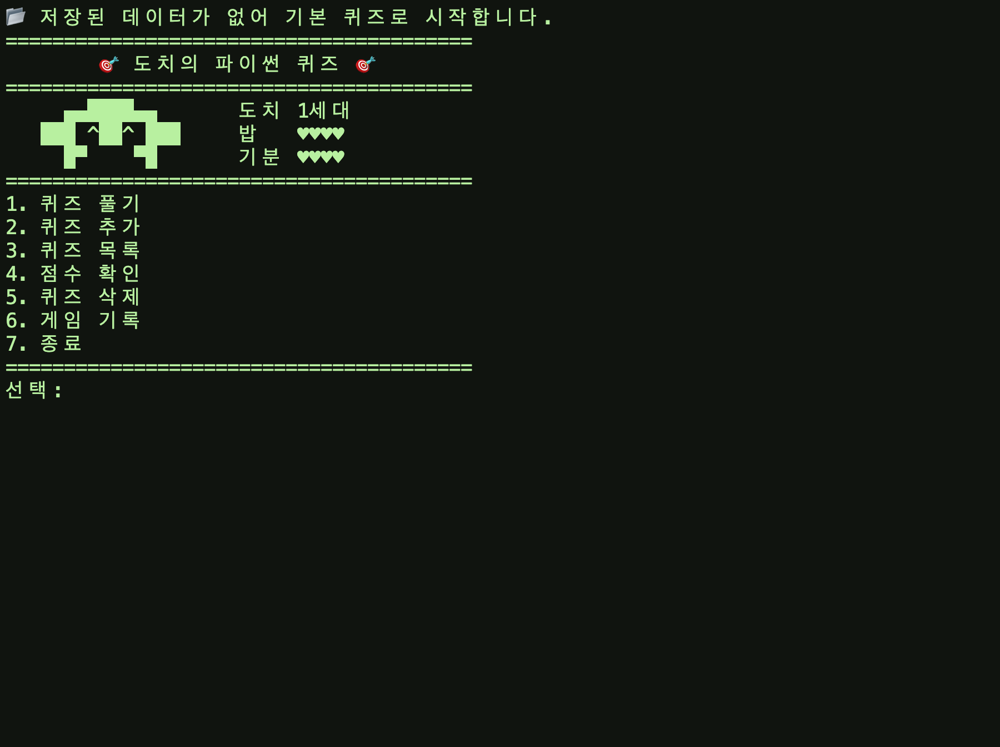
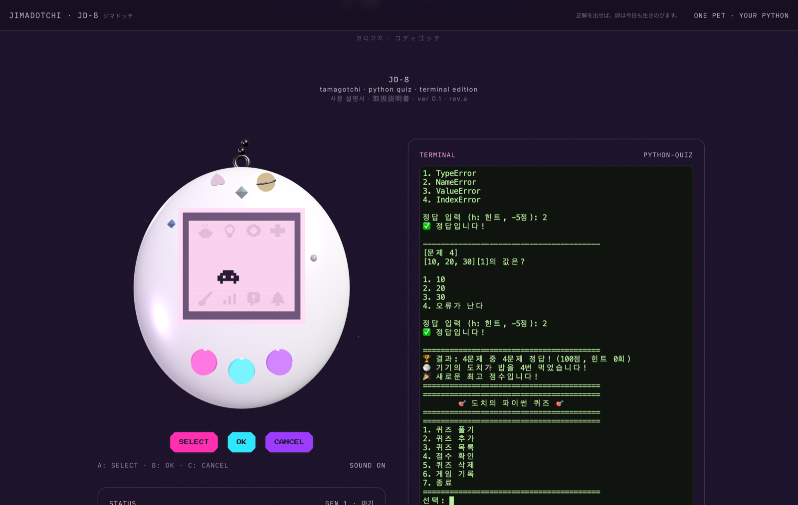
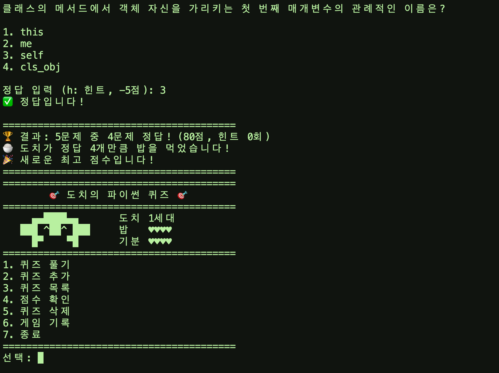
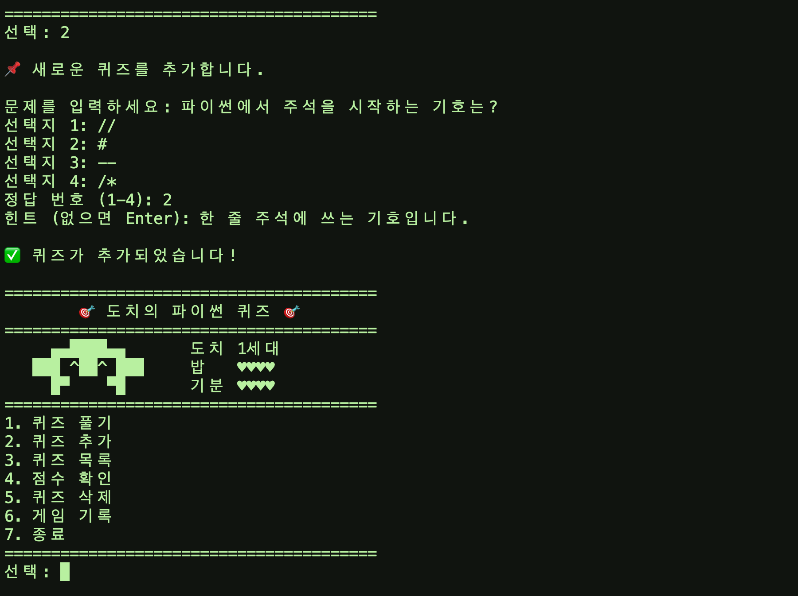
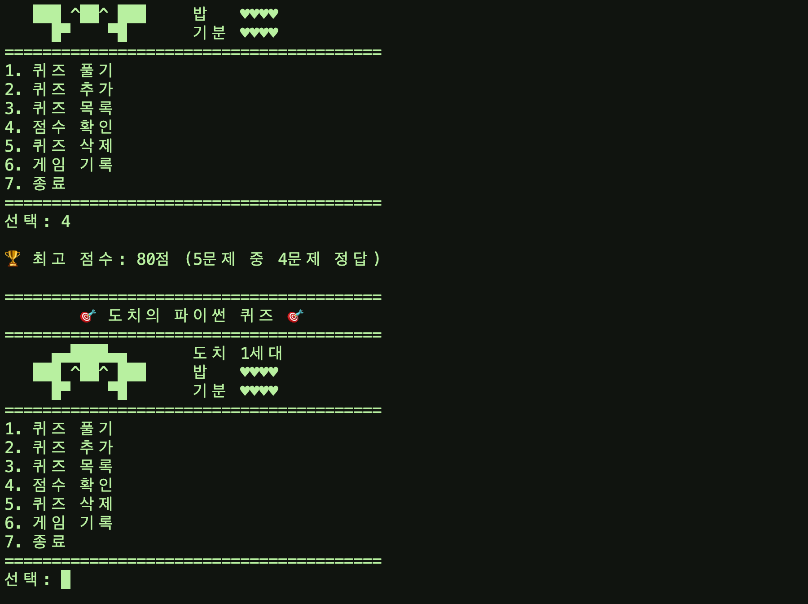

# python-quiz

터미널에서 파이썬 퀴즈를 풀어 도치를 키우는 게임입니다. Python 3.10 이상과 표준 라이브러리만으로 동작합니다.



## 프로젝트 개요

- 메뉴에서 번호를 골라 퀴즈 풀기, 추가, 목록, 점수 확인, 삭제, 기록 보기, 종료를 실행합니다.
- 퀴즈, 최고 점수, 게임 기록, 도치 상태를 `state.json`에 저장해 다시 실행해도 유지합니다.
- 잘못된 입력, Ctrl+C, 입력 스트림 종료, 파일 손상에도 멈추지 않습니다.
- 웹 터미널(ttyd)로 띄우면 접속한 모두가 같은 도치와 같은 퀴즈 목록을 공유합니다.
- JD-8 기기 화면과 함께 띄우면 터미널의 정답이 기기 속 도치의 밥이 됩니다(선택 기능).

이 프로젝트는 다마고치형 네트워크 게임 dotch-1을 입문 과제에 맞게 개량한 것입니다. dotch-1은 Next.js와 three.js로 만든 웹 게임이어서 코드를 가져오지 않았고, "파이썬 퀴즈 정답으로 도치 한 마리를 함께 살린다"는 규칙만 Python 콘솔 프로그램으로 새로 구현했습니다.

## 퀴즈 주제와 선정 이유

주제는 **파이썬과 Git 기초**입니다. 변수, 자료형, 반복문, 클래스, 파일 입출력, Git 명령은 이 과제를 만들며 직접 쓰는 내용이라, 문제를 만들고 푸는 과정이 그대로 복습이 됩니다. dotch-1도 파이썬 퀴즈로 도치를 돌보는 게임이어서 세계관을 이어 갈 수 있습니다.

## 실행 방법

```bash
git clone https://github.com/doji-kr/python-quiz.git
cd python-quiz
python3 main.py
```

Python 3.10 이상이면 되고, 설치할 외부 라이브러리는 없습니다.

게임을 끝내려면 메뉴의 `7`을 고르거나 Ctrl+C를 누르세요. 어느 쪽이든 저장됩니다.

### 브라우저에서 함께 플레이하기

Docker가 있으면 게임을 웹 터미널로 띄울 수 있습니다.

```bash
docker compose up -d --build
```

`http://<서버 주소>:8087`로 접속합니다. 접속마다 `main.py`가 하나씩 실행되고, 데이터는 `quiz-data` 볼륨의 `state.json`을 공유합니다. 인증이 없으므로 신뢰하는 네트워크 안에서만 여세요.

### JD-8 기기와 함께 실행하기 (선택)



dotch-1의 3D 기기 옆에 이 터미널을 붙인 로컬 전용판이 비공개 저장소 `dotch-1-terminal`에 있습니다. `docker compose up --build` 후 `http://localhost:8088`을 열면 됩니다. dotch-1의 웹 코드는 이 저장소에 없고, 그쪽이 이 저장소를 그대로 빌드해 씁니다.

환경 변수 `DOTCH_REWARD_URL`이 있으면 라운드가 끝날 때 결과를 그 주소로 보내고, 터미널의 도치 대신 기기의 도치를 키웁니다. 도치가 알 상태이거나 배가 부르거나 자고 있으면 기기가 거절하고, 터미널은 그 응답을 그대로 보여 줍니다. 변수가 없으면 지금까지처럼 터미널만으로 동작합니다.

### 8bit에서 실행하기

8bit은 자체 호스팅 게임 스토어입니다. `8bit/` 폴더가 스토어의 라이브러리 항목이며, dotch-1처럼 PLAY 버튼이 웹 터미널 서버로 바로 이동합니다.

```bash
sh 8bit/install.sh <라이브러리 폴더>/python-quiz http://<서버 주소>:8087
```

복사한 뒤 스토어의 라이브러리 재스캔을 실행하면 목록에 나타납니다.

## 기능 목록

| 메뉴 | 기능 |
|---|---|
| 1. 퀴즈 풀기 | 문제 수를 고르면 무작위로 출제하고, 정답 여부와 결과를 보여 줍니다. 풀이 중 `h`로 힌트를 봅니다(문제당 5점 차감). |
| 2. 퀴즈 추가 | 문제, 선택지 4개, 정답 번호, 힌트(선택)를 입력받아 저장합니다. |
| 3. 퀴즈 목록 | 등록된 문제를 번호와 함께 보여 줍니다. |
| 4. 점수 확인 | 최고 점수를 보여 줍니다. 풀 때마다 비교해 갱신합니다. |
| 5. 퀴즈 삭제 | 번호를 골라 지우고 파일에 반영합니다. |
| 6. 게임 기록 | 날짜와 시간, 문제 수, 정답 수, 힌트 횟수, 점수를 최근 10건 보여 줍니다. |
| 7. 종료 | 저장하고 끝냅니다. |

보너스 과제 5종(랜덤 출제, 문제 수 선택, 힌트, 삭제, 히스토리)을 모두 구현했습니다.

### 도치 규칙

| 하트 | 차는 때 | 주는 때 |
|---|---|---|
| 밥 (4칸) | 정답 1개마다 1칸 | 60분마다 1칸 |
| 기분 (4칸) | 라운드 전부 정답이면 1칸 | 180분마다 1칸 |

두 하트가 모두 빈 채로 24시간이 지나면 도치가 떠나고, 다음 정답에 새 세대가 옵니다. 백그라운드 작업 없이 마지막 저장 시각과의 차이로 계산합니다.

### 입력과 예외 처리

| 상황 | 동작 |
|---|---|
| 앞뒤 공백 (` 1 `) | 지우고 처리합니다. |
| 문자 (`abc`), 범위 밖 (`9`, 정답 `0`), 빈 입력 | 안내 후 다시 묻습니다. |
| Ctrl+C, 입력 스트림 종료(EOF) | 안내하고 저장한 뒤 정상 종료합니다. |
| `state.json` 없음 | 기본 퀴즈로 시작합니다. |
| `state.json` 손상 | 안내하고 원본을 `state.json.corrupt`로 옮긴 뒤 기본 퀴즈로 복구합니다. |
| 파일 읽기, 쓰기 오류 | 안내하고 메모리 상태로 계속합니다. |

## 파일 구조

```
python-quiz/
├── main.py              # 실행 파일. 저장 경로를 정하고 게임을 시작한다
├── game.py              # QuizGame: 메뉴, 출제, 점수, 기록, 저장 흐름
├── quiz.py              # Quiz: 문제 한 개의 출력, 정답 확인, 변환
├── pet.py               # Dotch: 도치의 하트와 세대
├── device.py            # Device: 함께 띄운 기기에 라운드 결과 전달 (선택)
├── storage.py           # StateStore: state.json 읽기, 쓰기, 잠금
├── console.py           # 입력 처리 공통 함수
├── default_quizzes.py   # 기본 퀴즈 8개
├── Dockerfile           # ttyd 웹 터미널 이미지
├── compose.yaml         # 웹 터미널 실행 설정
├── 8bit/                # 8bit 라이브러리 항목 (표지, 매뉴얼, 제작기)
├── docs/screenshots/    # 실행 화면
├── .gitignore
├── architecture.md      # 요구사항과 코드의 대응, 핵심 코드 설명
└── README.md
```

## 데이터 파일 설명

- **경로**: 프로젝트 루트의 `state.json`. 환경 변수 `QUIZ_STATE_PATH`로 바꿀 수 있습니다(웹 터미널은 `/data/state.json`).
- **역할**: 프로그램을 종료해도 퀴즈, 점수, 기록, 도치 상태를 유지합니다. 실행 중 만들어지는 데이터라 Git에는 올리지 않습니다.
- **인코딩**: UTF-8

| 필드 | 형식 | 설명 |
|---|---|---|
| `quizzes` | 목록 | 퀴즈 목록 |
| `quizzes[].question` | 문자열 | 문제 |
| `quizzes[].choices` | 문자열 4개 | 선택지 |
| `quizzes[].answer` | 정수 1-4 | 정답 번호 |
| `quizzes[].hint` | 문자열, 생략 가능 | 힌트 |
| `best_score` | 정수 0-100 또는 `null` | 최고 점수. 아직 풀지 않았으면 `null` |
| `best_correct`, `best_total` | 정수 | 최고 점수 때의 정답 수와 문제 수 |
| `history` | 목록 | 최근 게임 기록 100건 (`played_at`, `total`, `correct`, `hints`, `score`) |
| `pet` | 객체 | 도치 상태 (`hunger`, `mood`, `generation`, `updated_at`) |

```json
{
  "quizzes": [
    {
      "question": "[10, 20, 30][1]의 값은?",
      "choices": ["10", "20", "30", "오류가 난다"],
      "answer": 2,
      "hint": "인덱스는 0부터 셉니다."
    }
  ],
  "best_score": 80,
  "best_correct": 4,
  "best_total": 5,
  "history": [
    {
      "played_at": "2026-11-05T21:40:00+09:00",
      "total": 5,
      "correct": 4,
      "hints": 0,
      "score": 80
    }
  ],
  "pet": {
    "hunger": 4,
    "mood": 3,
    "generation": 1,
    "updated_at": "2026-11-05T21:40:00+09:00"
  }
}
```

## 설계 설명

요구사항이 코드 어디에 반영되어 있는지와 핵심 코드는 [architecture.md](architecture.md)에 정리했습니다.

### 클래스를 쓴 이유

퀴즈 한 개는 문제, 선택지, 정답, 힌트가 항상 함께 움직이고, 게임은 퀴즈 목록과 점수와 기록을 메뉴가 돌아가는 동안 계속 들고 있어야 합니다. 함수만으로 만들면 이 값들을 딕셔너리로 들고 다니며 함수마다 넘겨야 하고, `quiz["answer"]` 같은 키를 쓰는 곳이 여기저기 흩어져 형식이 바뀔 때 고칠 곳이 늘어납니다. 클래스로 묶으면 데이터와 그 데이터를 다루는 동작이 한곳에 모입니다. 대신 파일이 늘고 처음 읽을 때 흐름을 따라가기 조금 더 어렵습니다. 기능이 메뉴 하나뿐인 아주 작은 프로그램이라면 함수가 더 간단할 수 있습니다.

| 클래스 | 책임 | 분리한 이유 |
|---|---|---|
| `Quiz` | 문제 한 개의 출력, 정답 확인, 딕셔너리 변환 | 문제 형식의 규칙을 한곳에 둡니다 |
| `QuizGame` | 메뉴, 출제, 점수, 기록, 저장 시점 결정 | 게임 진행 순서만 맡습니다 |
| `StateStore` | 파일 읽기, 쓰기, 잠금, 손상 파일 격리 | 게임 규칙을 몰라도 되게 합니다 |
| `Dotch` | 도치의 하트와 세대 계산 | 시간 계산을 게임 흐름과 나눕니다 |
| `Device` | 기기에 라운드 결과 전달 (선택) | 네트워크 코드를 한 파일에 가둡니다 |

분리 기준은 **바깥 세계를 건드리는가**입니다. 키보드 입력과 검증은 `console.py`, 파일은 `storage.py`, 네트워크는 `device.py`에 두고, `quiz.py`와 `pet.py`는 입출력 없이 규칙을 계산합니다(`show`의 화면 출력은 예외입니다). `game.py`는 이들을 연결합니다.

### state.json을 읽고 쓰는 흐름

```
시작      load → 파일 없음: 기본 퀴즈로 시작
               → 손상: state.json.corrupt로 옮기고 기본 퀴즈로 복구
메뉴 표시  refresh (최신 상태 읽기, 실패하면 지금 상태 유지)
변경할 때  잠금 → refresh → 변경 → 임시 파일에 쓰기 → os.replace로 교체 → 잠금 해제
```

- **동시 접속:** 변경 전에 잠근 뒤 최신 상태를 다시 읽으므로, 여러 접속자가 동시에 저장해도 서로의 변경을 덮어쓰지 않습니다. 프로세스 6개가 각각 30개씩 동시에 추가해 180개가 모두 남는 것을 확인했습니다. 잠금은 `fcntl`을 쓰므로 Windows에서는 동작하지 않으며, 한 사람이 플레이할 때만 안전합니다.
- **풀이 중인 라운드:** 문제를 푸는 동안 다른 접속자가 퀴즈를 지워도 진행 중인 라운드는 시작할 때 뽑은 문제로 끝까지 진행합니다.
- **종료:** 메뉴의 `7`, Ctrl+C, 입력 스트림 종료는 모두 같은 저장 절차를 거칩니다. 전원이 나가는 등 강제로 꺼지면 마지막 변경은 사라질 수 있지만, 파일을 통째로 바꿔치기하므로 `state.json`이 반쯤 쓰인 채 남지는 않습니다.
- **쓰기 실패:** 재시도하지 않습니다. 안내를 출력하고 메모리 상태로 계속하며, 다음 변경 때 다시 저장을 시도합니다. 저장에 실패한 동안에는 다른 접속자의 변경을 읽어 오지 않으므로, 다시 저장되면 그 변경을 덮어쓸 수 있습니다.
- **손상 파일 보관:** `state.json.corrupt`는 한 개만 남습니다. 다시 손상되면 이전 백업을 덮어쓰므로, 필요한 내용은 다음 실행 전에 옮겨 두어야 합니다.

### JSON을 고른 이유와 한계

JSON은 표준 라이브러리로 읽고 쓸 수 있고 사람이 직접 열어 고칠 수 있어, 문제 수십 개짜리 게임에 알맞습니다. 대신 일부만 바꿀 수 없어 저장할 때마다 파일 전체를 다시 쓰고, 읽을 때도 전체를 메모리에 올립니다. 이 저장 코드로 직접 재 본 결과는 다음과 같습니다(Apple Silicon 맥, 측정 환경에 따라 달라집니다).

| 퀴즈 수 | 파일 크기 | 저장 | 읽기 |
|---|---|---|---|
| 100개 | 22KB | 1ms | 1ms 미만 |
| 1만 개 | 2.2MB | 56ms | 12ms |
| 10만 개 | 22MB | 542ms | 130ms |

메뉴를 표시할 때마다 읽고 저장하는 동안 잠금을 잡고 있으므로, 데이터가 커지면 모든 접속자가 함께 느려집니다. 수만 개 이상을 다루거나, 접속자가 많거나, 검색과 부분 수정이 필요해지면 표준 라이브러리에 있는 `sqlite3`로 옮기는 것이 다음 단계입니다. `load`와 `save`가 `StateStore`에 모여 있어 게임 규칙은 거의 고치지 않아도 됩니다.

### 요구사항이 바뀔 때 고칠 곳

| 바뀌는 내용 | 고칠 곳 | 주의할 점 |
|---|---|---|
| 퀴즈 주제 | `default_quizzes.py` | 이미 있는 `state.json`의 문제는 그대로입니다 |
| 메뉴 항목 추가 | `QuizGame.show_menu`, `handle_choice`, `run`의 번호 범위 | 범위 `1, 7`이 `run`에 직접 적혀 있습니다 |
| 선택지 개수 | `quiz.py`의 `CHOICE_COUNT`, `default_quizzes.py` | 이전 `state.json`은 검증에 실패해 `.corrupt`로 옮겨집니다 |
| 힌트 감점 | `game.py`의 `HINT_PENALTY` | 점수 계산은 `QuizGame.play`에 있습니다 |
| 저장할 값 추가 | `QuizGame.save`, `apply_state` | 이전 파일에는 없는 값이므로 기본값을 정해야 손상으로 처리되지 않습니다 |
| 기록 보관 개수 | `game.py`의 `MAX_HISTORY` | 화면에는 `show_history`가 최근 10건만 보여 줍니다 |
| 도치 규칙 | `pet.py` 위쪽 상수, `Dotch.reward` | 기기와 함께 쓸 때는 기기 쪽 규칙이 적용됩니다 |
| 저장소를 DB로 교체 | `storage.py` | `QuizGame`은 `load`, `save`, `lock`, `set_aside`만 부릅니다 |

## Git 작업 기록

### 커밋 규칙

- 커밋 하나에는 하나의 목적만 담습니다. 기능 추가와 오류 수정을 한 커밋에 섞지 않습니다.
- 제목은 `종류: 무엇을 했는지` 형식으로 씁니다.

| 종류 | 쓰는 때 | 이 저장소의 예 |
|---|---|---|
| `Feat` | 기능 추가 | `Feat: 힌트와 점수 차감 추가` |
| `Fix` | 오류 수정 | `Fix: quizzes 키가 없는 state.json에서 비정상 종료되는 오류 수정` |
| `Docs` | 문서 수정 | `Docs: README 작성` |
| `Refactor` | 동작을 바꾸지 않는 구조 변경 | `Refactor: QuizGame을 game.py로 분리` |
| `Chore` | 기능과 무관한 설정 | `Chore: 프로젝트 초기 설정` |

### 브랜치와 병합

`main`은 언제나 실행되는 상태로 두고, 큰 기능은 브랜치에서 만들었습니다. 만드는 도중에 망가져도 `main`에 영향이 없고, 기능의 커밋이 그래프에서 한 덩어리로 보입니다. 혼자 작업하므로 Pull Request 없이 다음 순서로 합쳤습니다.

```bash
git checkout -b feature/bonus       # 브랜치를 만들고 이동
git add . && git commit             # 기능 단위로 커밋
git checkout main                   # main으로 돌아와
git merge --no-ff feature/bonus     # 병합 커밋을 남기며 합침
git push origin main feature/bonus  # 원격에 올림
```

`--no-ff`를 쓰면 브랜치의 흔적이 그래프에 남습니다. `feature/play-quiz`와 `feature/bonus` 두 브랜치를 이렇게 병합했고, 두 브랜치 모두 원격에 남아 있습니다.

### 커밋 이력

`git log --oneline --graph`의 실제 출력입니다. 이 문서를 추가하기 직전 기준으로 커밋은 27개이고 그중 병합은 2개입니다.

```
* 6429c65 Fix: 저장 실패 후 메뉴로 돌아오면 방금 바꾼 내용이 사라지는 오류 수정
* f3e5f39 Docs: README에 종료 방법 추가
* 1b6576f Docs: 실행 화면과 기기 연동 설명 추가
* 3d63b2a Fix: 기기가 밥을 거절해도 먹었다고 안내하던 문제 수정
* 74284e0 Feat: 함께 띄운 기기에 라운드 결과를 전달
* 613506f Docs: README 작성
* 52e229e Feat: 8bit 라이브러리 패키지 추가
* 16cd20b Feat: ttyd 웹 터미널로 실행하는 Docker 구성 추가
* 253cf81 Feat: 여러 접속자가 같은 상태를 공유하도록 저장 방식 변경
* a859d13 Feat: 정답으로 키우는 도치 추가
*   e2e91ad Merge: feature/bonus를 main에 병합
|\  
| * 0dea68f Feat: 게임 기록 히스토리 추가
| * 347adcb Feat: 퀴즈 삭제 추가
| * de3042c Feat: 힌트와 점수 차감 추가
| * 848b18e Feat: 문제 수 선택과 랜덤 출제 추가
| * 958dfcf Fix: quizzes 키가 없는 state.json에서 비정상 종료되는 오류 수정
|/  
* 5da45db Feat: state.json 저장과 불러오기 구현
* 3309165 Refactor: QuizGame을 game.py로 분리
* 7b5fb77 Feat: 최고 점수 확인과 갱신 구현
* c6a9346 Feat: 퀴즈 목록 기능 구현
* 8a509e5 Feat: 퀴즈 추가 기능 구현
*   97bda59 Merge: feature/play-quiz를 main에 병합
|\  
| * 103d905 Feat: 퀴즈 풀기 기능 구현
|/  
* 8c44830 Feat: 파이썬과 Git 기초 기본 퀴즈 8개 작성
* 963af0a Feat: Quiz 클래스 작성
* 78a5edf Feat: 메뉴와 공통 입력 처리 구현
* 1ca9395 Chore: 프로젝트 초기 설정
```

## 실행 화면

| 메뉴 | 퀴즈 풀기 |
|---|---|
|  |  |

| 퀴즈 추가 | 점수 확인 |
|---|---|
|  |  |
